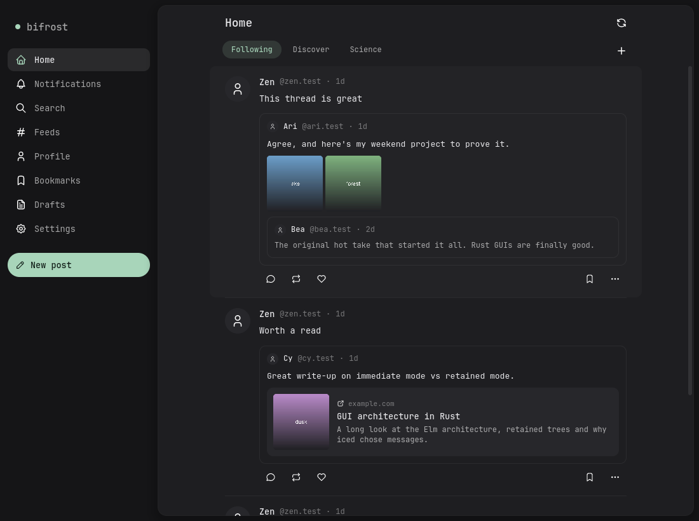
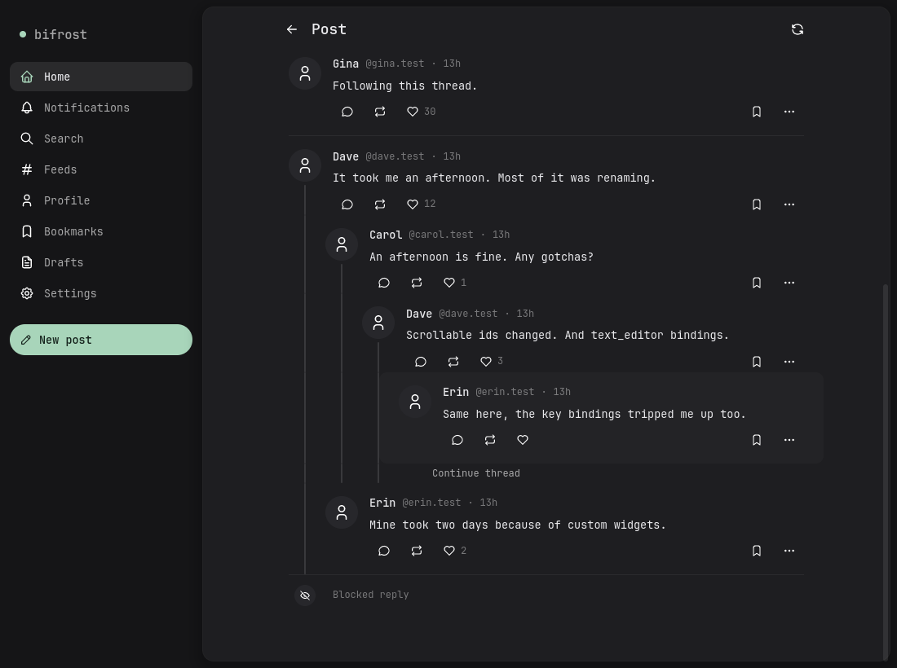
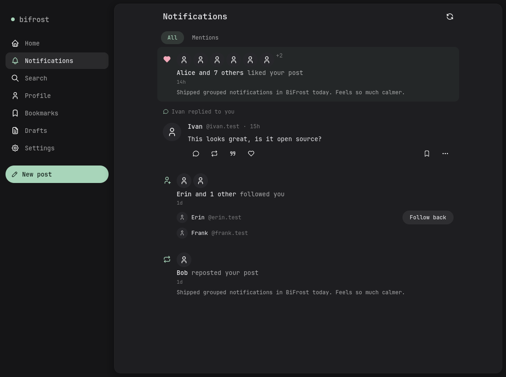
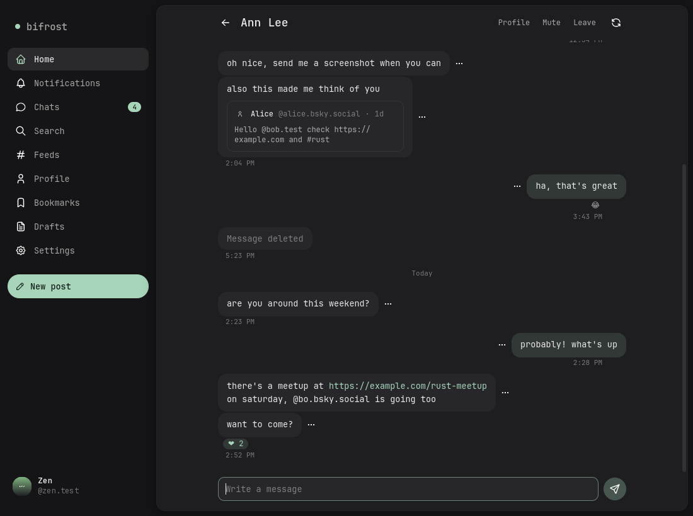
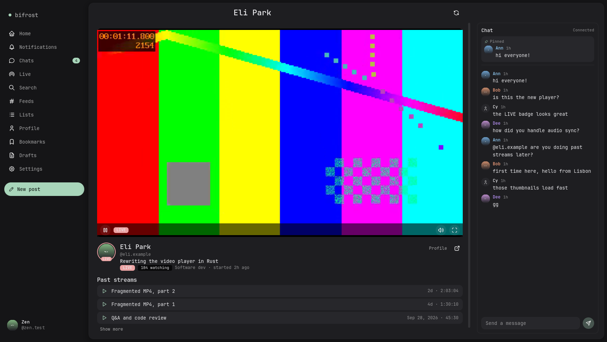

# BiFrost

[](https://github.com/nickmorell/bifrost/actions/workflows/ci.yml)

**A native desktop client for Bluesky and the wider AT Protocol network.**
Written in Rust with [iced](https://iced.rs) for Windows, macOS and Linux. No browser engine, no telemetry, and
every connection to an outside service is off until you turn it on.



> **Status: early.** BiFrost is version 0.1. Download it for Windows, macOS or Linux from the
> [Releases page](https://github.com/nickmorell/bifrost/releases), or [build it from source](#building-from-source).
> It is used daily on Windows; Linux builds and runs; macOS has not been tested yet. Expect rough edges and please
> report them.

## Why BiFrost

- **Native and light.** A real desktop app with a calm, roomy look, keyboard-friendly windows and a system tray
  icon, instead of a website in a frame.
- **Free, all of it.** Several accounts, drafts, scheduled posts, columns, DeepL translation and private
  collections are all included. Nothing is behind a subscription.
- **Local first.** Your reading position, filters, search index and collections live on your computer. Bluesky
  never sees them.
- **A home for the AT Protocol.** Bluesky is one of many apps built on the AT Protocol. BiFrost aims to be the
  one place to use them, all with the account you already have. Live video from Streamplace and long-form
  articles from Standard.site and WhiteWind already work; more apps are on the [roadmap](#roadmap).
- **Off by default.** Every integration with an outside service is switched off until you turn it on, and a
  switched-off integration makes no network requests at all.

## Features

**Reading**

- Home with your pinned feeds and lists as tabs, or **deck mode** with any number of columns side by side
- Threads with reply lines, rich quotes, image galleries with a full-screen viewer, GIFs and a built-in video
  player
- Keeps your place in every feed, and per-feed filters: hide reposts, replies or quotes, media only, a minimum
  number of likes
- Grouped notifications, with optional desktop notifications and a tray icon
- Profiles, custom feeds, lists and starter packs
- A long-form article reader, top links shared by people you follow today, and offline reading of posts you
  have already seen

**Writing**

- Composer with mentions, hashtags, link cards, up to four images with alt text (and a reminder when it is
  missing), video upload, post language and content warnings
- Threads: write a long post and split it into numbered posts, or mark the breaks yourself with `---`
- Drafts, scheduled posts, and controls for who can reply to and quote your posts

**Everything else**

- Direct messages: one-to-one and group chats, message requests, reactions and shared posts
- Search on Bluesky, plus **local full-text search** of everything you have seen, with `from:`, `since:`,
  `until:`, `domain:` and `is:` filters
- Bookmarks and private collections kept on your computer
- Moderation: Bluesky's content labels, muted words, muted and blocked accounts, moderation lists, and a
  warning before opening links whose text points somewhere else
- Translation through MyMemory, DeepL, LibreTranslate or your browser
- Privacy settings: keep your posts out of Discover, hide them from logged-out viewers, and set default reply
  and quote rules
- Your own posting statistics, computed on your computer
- Several accounts, signing in with OAuth or an app password
- Dark, light and match-system themes, text size zoom, and a data saver mode

## Screenshots

The screenshots use made-up sample accounts.

| Thread | Notifications |
| --- | --- |
|  |  |
| **Chat** | **Live video** |
|  |  |

## Integrations

All integrations are off by default and are turned on one by one in **Settings**. The table says who BiFrost
talks to once you do.

| Integration | What it does | Who BiFrost contacts |
| --- | --- | --- |
| YouTube, YouTube Shorts, Vimeo, Twitch | Video cards for links | The service, for thumbnails |
| Spotify, Apple Music, SoundCloud, Bandcamp | Music cards; Bandcamp tracks play inside BiFrost | The service |
| GIPHY, Tenor, KLIPY | GIFs play in place | The GIF service |
| Flickr, FreeMix | Photo and mix cards | The service |
| Streamplace | A Live screen, streamer pages, live chat and LIVE rings on avatars | Streamplace |
| Translation | Translate posts on request | MyMemory, DeepL or a LibreTranslate server you choose |

## Privacy and security

- **No telemetry, no analytics, no crash reporting.** BiFrost talks to Bluesky and the AT Protocol services it
  needs (your account's server, the PLC directory, handle lookups over DNS-over-HTTPS) and to the services you
  switch on, nothing else.
- **Tokens never touch disk.** Sign-in tokens and API keys are kept in your operating system's credential store
  (Windows Credential Manager, macOS Keychain, or the Secret Service on Linux).
- **Uploads are cleaned.** Image metadata, including GPS location, is removed before upload.
- **Your files stay yours.** Settings, drafts and the account list are kept in `%APPDATA%\bifrost` on Windows,
  `~/Library/Application Support/bifrost` on macOS and `~/.config/bifrost` on Linux. The image cache and kept
  posts are in `%LOCALAPPDATA%\bifrost`, `~/Library/Caches/bifrost` or `~/.cache/bifrost`. On macOS and Linux
  these folders are readable by you alone. **Settings → Remove all BiFrost data** deletes all of it.

Found a security problem? Please report it privately, as described in [SECURITY.md](SECURITY.md), instead of
opening a public issue. Every download on the Releases page has a signed build provenance attestation; SECURITY.md
shows how to check one.

## Building from source

You need **Rust 1.92 or newer** ([rustup](https://rustup.rs)) and a C/C++ compiler, because the video decoder
(OpenH264) is built from source.

**Windows:** install the Rust MSVC toolchain and the
[Visual Studio Build Tools](https://visualstudio.microsoft.com/visual-cpp-build-tools/) with the
*Desktop development with C++* workload.

**macOS:** install the Xcode command line tools with `xcode-select --install`.

**Linux** (Debian and Ubuntu package names; other distributions have equivalents):

```sh
sudo apt install build-essential pkg-config libssl-dev libasound2-dev libdbus-1-dev \
  libgtk-3-dev libxdo-dev libayatana-appindicator3-dev
```

Then build and run:

```sh
git clone https://github.com/nickmorell/bifrost.git
cd bifrost
cargo run --release
```

The first release build takes several minutes because the whole program is optimised as one unit.

### Signing in

Choose **Sign in with your browser** (OAuth), or sign in with your handle and an
**app password** (Bluesky → Settings → Privacy and security → App passwords). You can add more accounts later
and switch between them from the sidebar.

## Development

```sh
cargo fmt
cargo clippy --all-targets -- -D warnings
cargo test
```

All three must pass before a change is done. `cargo test -- --ignored` also checks parsing against live data
from Bluesky's public API.

BiFrost is a single crate split into modules that each do one job: `model` (data types), `net` (HTTP),
`auth`, `api`, `storage`, `platform` (everything that differs between Windows, macOS and Linux), `theme`,
`components`, `features` (one folder per screen or feature) and a thin `app` shell that wires them together.
Which module may use which is checked by `tests/architecture.rs`, and the full rules are in
[CLAUDE.md](CLAUDE.md).

GitHub Actions runs the same three checks on Windows, macOS and Linux for every pull request and every push
to `main`, and lints the workflows themselves with [zizmor](https://docs.zizmor.sh) (`.github/workflows/ci.yml`).
Every action is pinned to a commit. `.github/workflows/audit.yml` checks the dependencies against the
[RustSec advisory database](https://rustsec.org) every week (exceptions and their reasons are in `deny.toml`),
and Dependabot proposes dependency and action updates once a month.

### Making a release

1. Set the new `version` in `Cargo.toml` and commit it to `main`.
2. Tag that commit and push the tag: `git tag v0.1.0 && git push origin v0.1.0`.
3. `.github/workflows/release.yml` builds the Windows, macOS (Apple silicon and Intel) and Linux downloads and
   attaches them to a **draft** release, with a build provenance attestation for each file. Check the notes on the
   [Releases page](https://github.com/nickmorell/bifrost/releases), then publish it.

The build stops if the tag and the version in `Cargo.toml` differ.

## Roadmap

1. **An Integrations page** that shows every switch and exactly what each one sends where.
2. **More of the AT Protocol network:** show which AT Protocol apps a person uses on their profile, then cards
   for events with RSVP (Smoke Signal), code (Tangled), reviews (Popfeed, BookHive), photos (Flashes, Grain)
   and what people are listening to (teal.fm).
3. **Own your data:** a full backup of your account and images to your computer.

### Not planned

These won't be added, so issues asking for them are closed with a link here:

- **A mobile app.** BiFrost is for Windows, macOS and Linux desktops.
- **Plugins or extensions.** Every feature is built in, reviewed and off by default when it contacts someone.
- **AI features.** No AI summaries, AI-ranked timelines or AI writing help (see
  [How BiFrost is made](#how-bifrost-is-made)).
- **Accounts on big outside services** (Spotify, GitHub, Twitch and similar). BiFrost grows toward the
  AT Protocol network instead.
- **Cross-posting** to X, Mastodon, Threads or other networks.
- **Telemetry or analytics** of any kind.

## How BiFrost is made

BiFrost is a personal project, and it is being built with a lot of help from AI coding tools (Claude). We want
to be upfront about that. The app itself is deliberately **AI-free**: there are no AI features, no AI-ranked
timelines and no AI writing in your posts. Social media should stay a place for people.

## Contributing

Bug reports and requests are welcome through the [issue forms](https://github.com/nickmorell/bifrost/issues/new/choose),
and questions and ideas in [Discussions](https://github.com/nickmorell/bifrost/discussions). Pull requests are
welcome too, AI-assisted ones included. [CONTRIBUTING.md](CONTRIBUTING.md) says how issues are handled and what
a pull request needs. BiFrost is a curated app rather than a platform, so check the [not planned](#not-planned)
list before asking for something big.

## License

BiFrost is licensed under the [Apache License, Version 2.0](LICENSE).

Bundled assets keep their own licenses: [JetBrains Mono](https://www.jetbrains.com/lp/mono/) under the
[SIL Open Font License](assets/fonts/OFL.txt), and [Tabler Icons](https://tabler.io/icons) under the
[MIT license](assets/TABLER-ICONS-LICENSE).

## Acknowledgements

BiFrost stands on [iced](https://iced.rs), [ATrium](https://github.com/atrium-rs/atrium) (the Rust AT Protocol
libraries), [OpenH264](https://www.openh264.org), [Symphonia](https://github.com/pdeljanov/Symphonia),
[rodio](https://github.com/RustAudio/rodio) and many other open-source crates, and on the
[AT Protocol](https://atproto.com) itself. BiFrost is an independent project and is not affiliated with
Bluesky Social PBC.
